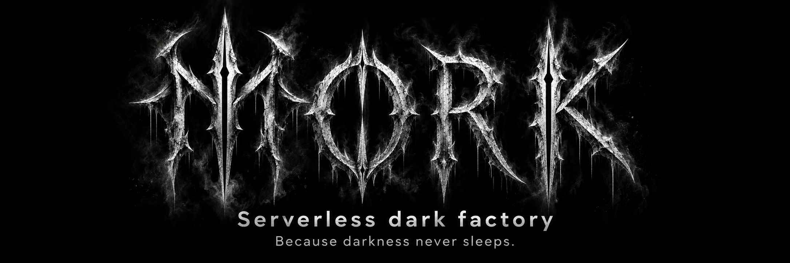
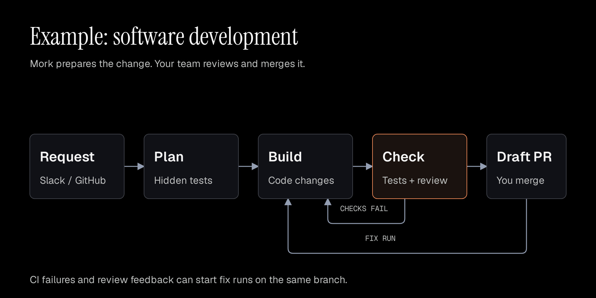

Mork is a serverless dark factory for AI workflows. Give it a task in Slack,
and it runs the steps you configured and returns the result.

Use it to prepare code changes, analyze data or produce a report. Decide which
steps use an AI agent, which run a command and which require human approval.
Deploy it in your AWS account and choose your model provider.

[Configure a workflow](docs/workflows.md) · [Deploy Mork](docs/deployment.md) · [How it works](docs/architecture.md)

## Architecture


Mork uses AWS Step Functions to coordinate work and starts Fargate containers for
agent and command steps. Human approval pauses the workflow without keeping a
runner active. Lambda functions handle requests and delivery. S3 stores artifacts,
and DynamoDB stores the development decision timeline.

See the [architecture](docs/architecture.md) for verification, decision models,
supervision and deployment details. [SOCI packaging](docs/image-startup.md) is
available for container startup optimization.

## Example: software development



The development workflow plans the change, writes code and checks the result
before opening a draft pull request. Hidden acceptance tests, repository tests
and an independent review help your team assess the change. A person merges.

Configure the prompts, tools, models and limits for **Plan, Build and Check**.
These operations run in that order. Failed checks can trigger another build
attempt. Failed CI, requested changes or an `@mork` comment can start a fix run
on the same branch.

## What can your team delegate?

| Work | What Mork does | What your team receives |
| --- | --- | --- |
| Software changes | Plans the change, writes code, runs tests and reviews it | A draft PR with checks and a review recommendation. A person merges. |
| Data analysis | Runs your analysis steps and validates their output | A report in the Slack thread, with saved artifacts |
| Reports and dashboards | Runs agents and your service commands, with approval where needed | A reviewed result or an update published by your command |

Analysis and publishing depend on the tools, data access and commands you supply.
Slack, GitHub and Jira integrations are included. Connect other services through
the tools and commands you supply, with credentials scoped to each step.

## Build the workflow around the job

Configure each workflow's instructions, tools, model, checks and time limits.
One Slack app can serve several workflows. It selects among the workflows you
allow in each channel and asks for clarification when the request is ambiguous.

Other workflows combine **agent, command and approval steps**. Pass results
between steps, require structured output and ask a person to approve before the
next step or publication. For example, an agent can prepare a report, a command
can validate it and a person can approve its release.

See [workflow examples and configuration](docs/workflows.md).

## Keep people in control

- Review the result in the original Slack thread. Mork can ask questions there
  when it needs more information.
- Choose the checks that define success. For development, tests and repository
  checks determine whether the change passes; model advice cannot override them.
- Inspect saved outputs, session logs and the development decision timeline.
  Development supervision tracks progress during agent runs. Optional OTLP export
  sends development logs to your logging system.
- Choose an OpenAI-compatible model provider. Configure credentials and allowed
  domains for each step. Read the [security boundaries and known gaps](SECURITY.md).

## Get started

You need an AWS account, a Slack app and model-provider credentials. Slack routing
uses Jev. Development needs GitHub access, and Slack development requests also need
a Jira project.

1. [Deploy Mork](docs/deployment.md) and connect your team's tools.
2. [Define your workflows](docs/workflows.md) and allow them in the relevant Slack channels.
3. Mention `@mork` in a channel and describe the work. Development can also start
   from a GitHub issue labeled `mork`.

Mork is experimental. The current workflows pass local integration tests and tests
against production images. This revision has not been validated on a fresh AWS
deployment. Read [SECURITY.md](SECURITY.md) before giving it access to important code or data.

## Documentation and contributing

| Guide | Contents |
| --- | --- |
| [Workflows](docs/workflows.md) | Development, analysis, commands and approval steps |
| [Deployment](docs/deployment.md) | AWS setup, repositories and Slack |
| [Configuration](docs/configuration.md) | Secrets, deployment settings and repository checks |
| [Architecture](docs/architecture.md) | Execution, verification and supervision |
| [Security](SECURITY.md) | Trust boundaries and known gaps |
| [Local verification](docs/local-verification.md) | Run workflows and checks without AWS |
| [Contributing](CONTRIBUTING.md) | Development setup and review |
| [Glossary](CONTEXT.md) · [Decisions](docs/adr/) | Project terminology and design decisions |
| [Diagrams](docs/diagrams/) | Editable diagram sources |
| [Releasing](docs/releasing.md) · [Third-party notices](THIRD_PARTY_NOTICES.md) | Release checks and dependency licenses |

<details>
<summary>Run development checks locally</summary>

```sh
mise trust
mise install
mise run install
mise run check
```

Tests run with Bun. Production images execute bundled JavaScript on Node 24.
`workflow:local` runs development without AWS; `workflow:configured` runs generic
steps. See [local verification](docs/local-verification.md).

</details>

Licensed under the [Apache License 2.0](LICENSE).
